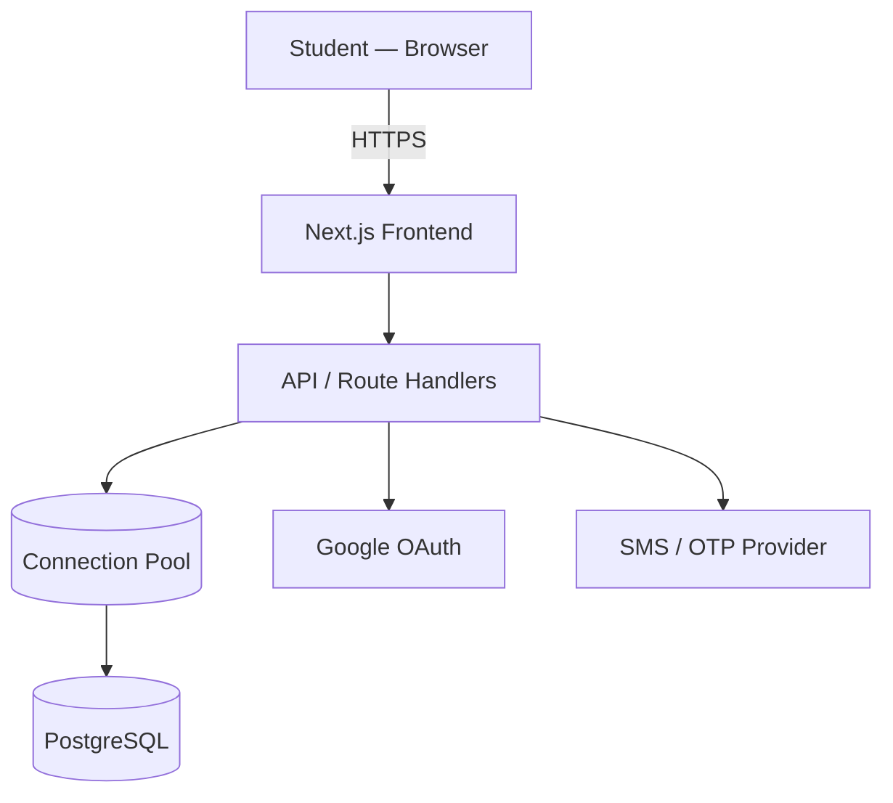
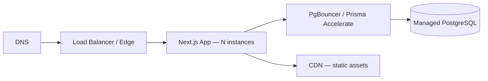

# TestPrep — High-Level Design (HLD)

**Rev 1.0 · 23 Sep 2026 · companion to the Architecture Blueprint**

## 1. Purpose & Scope
TestPrep is a mock-test platform for two audiences: government-exam aspirants (SSC, Banking, Railways, Defence, UPSC, State) and service-based-company job seekers (TCS, Infosys, Wipro, Cognizant, Accenture, Capgemini). This document describes the system at a component level — schemas, contracts, and algorithms live in the companion LLD.

## 2. Architectural Style
- A modular monolith for the MVP, organized by **feature**, not by layer.
- Server Components render read-heavy pages; Client Components own only interaction — timer, palette, forms, charts.
- The backend is the sole gatekeeper to PostgreSQL. The browser never talks to the database directly.

## 3. System Context Diagram

## 4. Major Subsystems
| Subsystem | Responsibility |
|---|---|
| Identity & Onboarding | Google/OTP auth, profile capture (focus area, college, year, course) |
| Exam Catalog | Categories, exams, subjects — browsing and search |
| Test Engine | Timer, question palette, section navigation, autosave — its own isolated bundle |
| Scoring & Results | Server-side scoring, section-wise breakdown |
| Engagement | Streaks, badges, bookmarks, leaderboard |
| Content Protection | Frontend deterrents + backend enforcement — detail in LLD §7 |
| Admin (Phase 4) | Question authoring, exam management — a separate app |

## 5. External Integrations
| Integration | Used for | Status |
|---|---|---|
| Google OAuth | Sign-in | Required |
| SMS/OTP gateway | Mobile verification | Not yet chosen — MSG91, Twilio Verify, and Firebase Auth all fit; decide on India-delivery reliability and cost |
| CDN | Serving WebP/SVG assets | Recommended for launch, not required for MVP |

## 6. Key Journeys
Full sequence diagrams are in LLD §4. At this level:
- Sign up → onboarding → dashboard
- Browse exams → start test → answer → autosave → submit → result
- Earn a streak or badge → see it reflected on the dashboard

## 7. Non-Functional Requirements
| Concern | Approach |
|---|---|
| Performance | Server Components for first paint; DB pool kept warm on page load (Blueprint Sheet 07); questions paginated per section, never bulk-loaded |
| Scalability | Stateless API instances behind a load balancer; feature-based code splitting keeps bundles small as the catalog grows |
| Security | Correct answers and the full question bank never reach the browser; the server validates score and attempt duration; the question API is rate-limited and audited |
| Availability | Warm-up reduces but doesn't eliminate cold starts on serverless/free-tier hosts — pair it with a persistent pooler if you go serverless |

## 8. Deployment View

- **Frontend + API:** Vercel, or containerized Node behind a load balancer.
- **Database:** managed Postgres (Neon, Supabase, or RDS) with a pooler in front — serverless functions open far more connections than a traditional long-running server does.
- **Environments:** dev → staging → prod, identical schema, isolated data.

## 9. Conceptual Data Model
`User · ExamCategory · Exam · Subject · Test · Question · TestAttempt · AttemptAnswer · Badge · Streak · Bookmark · Company`
Full column-level schema, types, and relationships are in the LLD.

## 10. Assumptions & Open Decisions
- OTP/SMS provider is not yet selected.
- Single-region deployment for MVP; multi-region only if real latency data justifies it.
- Company logos are placeholder SVGs until official brand assets are sourced.
- The admin app (Phase 4) is out of scope for this revision.
