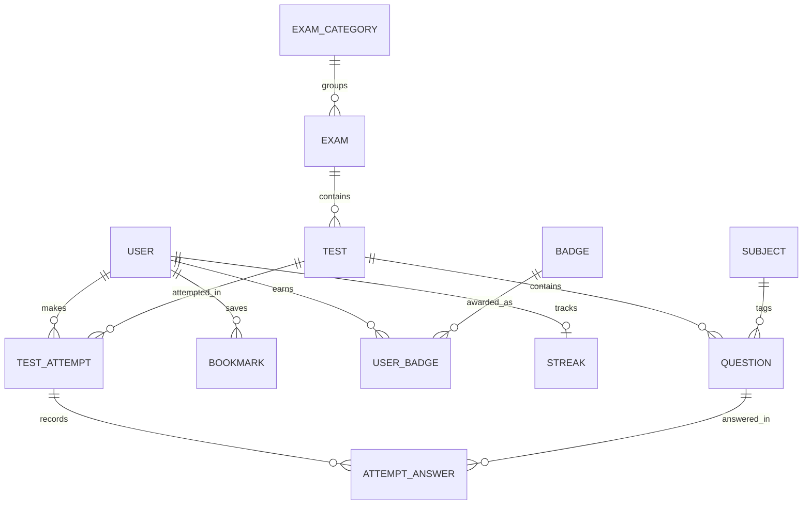
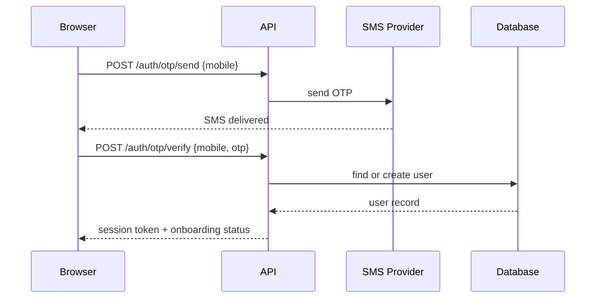
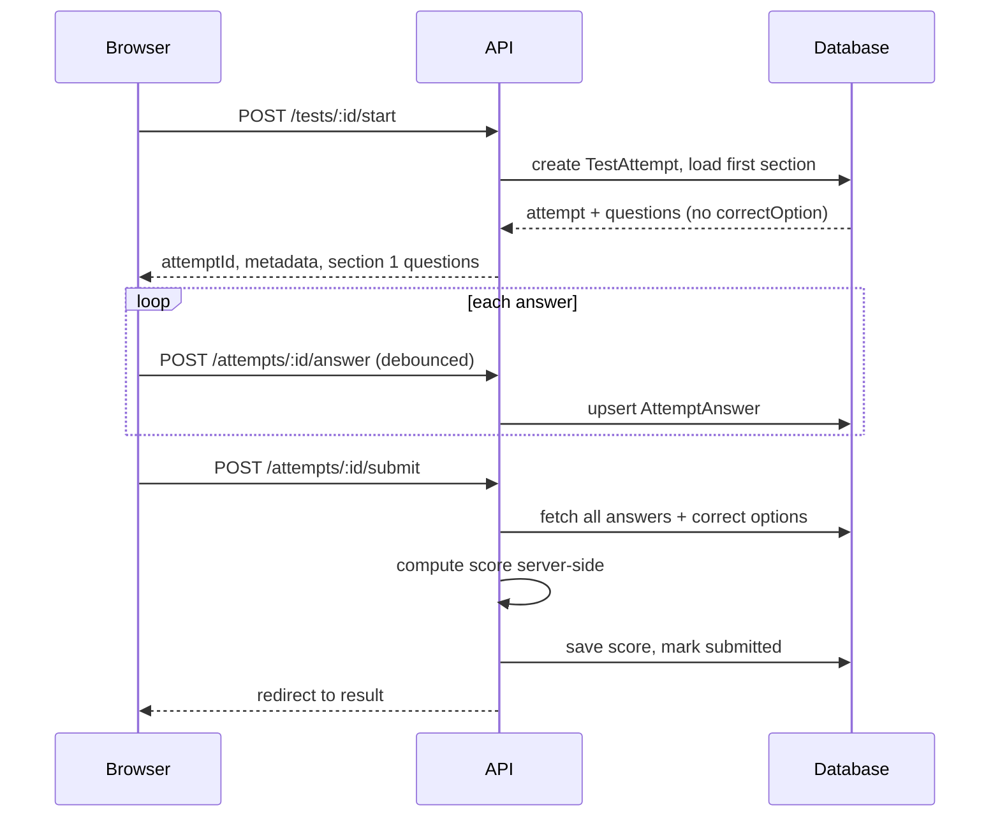

# TestPrep — Low-Level Design (LLD)

**Rev 1.0 · 23 Sep 2026 · companion to the HLD**

## 1. Database Schema (Prisma)
```prisma
model User {
  id         String   @id @default(cuid())
  name       String
  email      String?  @unique
  mobile     String?  @unique
  googleId   String?  @unique @map("google_id")
  focusArea  String   @map("focus_area")   // "government" | "service_companies" | "both"
  college    String?
  year       String?
  course     String?
  createdAt  DateTime @default(now()) @map("created_at")

  attempts   TestAttempt[]
  bookmarks  Bookmark[]
  badges     UserBadge[]
  streak     Streak?

  @@map("users")
}

model ExamCategory {
  id    String @id @default(cuid())
  name  String
  icon  String
  exams Exam[]

  @@map("exam_categories")
}

model Exam {
  id         String       @id @default(cuid())
  categoryId String       @map("category_id")
  category   ExamCategory @relation(fields: [categoryId], references: [id])
  name       String
  tests      Test[]

  @@map("exams")
}

model Subject {
  id        String     @id @default(cuid())
  name      String
  icon      String
  questions Question[]

  @@map("subjects")
}

model Test {
  id             String        @id @default(cuid())
  examId         String        @map("exam_id")
  exam           Exam          @relation(fields: [examId], references: [id])
  title          String
  durationMin    Int           @map("duration_min")
  totalQuestions Int           @map("total_q")
  marksCorrect   Int           @default(4) @map("marks_correct")
  marksNegative  Int           @default(1) @map("marks_negative")
  questions      Question[]
  attempts       TestAttempt[]

  @@map("tests")
}

model Question {
  id            String          @id @default(cuid())
  testId        String          @map("test_id")
  test          Test            @relation(fields: [testId], references: [id])
  subjectId     String          @map("subject_id")
  subject       Subject         @relation(fields: [subjectId], references: [id])
  text          String
  options       Json            // [{ id:"A", text:"3" }, ...]
  correctOption String          @map("correct_option")  // stripped before any client-facing query
  explanation   String?
  answers       AttemptAnswer[]

  @@index([testId, subjectId])
  @@map("questions")
}

model TestAttempt {
  id          String          @id @default(cuid())
  userId      String          @map("user_id")
  user        User            @relation(fields: [userId], references: [id])
  testId      String          @map("test_id")
  test        Test            @relation(fields: [testId], references: [id])
  startedAt   DateTime        @default(now()) @map("started_at")
  submittedAt DateTime?       @map("submitted_at")
  status      String          @default("in_progress")  // in_progress | submitted | auto_submitted
  score       Int?
  answers     AttemptAnswer[]

  @@index([userId, testId])
  @@map("test_attempts")
}

model AttemptAnswer {
  id             String      @id @default(cuid())
  attemptId      String      @map("attempt_id")
  attempt        TestAttempt @relation(fields: [attemptId], references: [id])
  questionId     String      @map("question_id")
  question       Question    @relation(fields: [questionId], references: [id])
  selectedOption String?     @map("selected_option")
  markedReview   Boolean     @default(false) @map("marked_review")
  answeredAt     DateTime    @updatedAt @map("answered_at")

  @@unique([attemptId, questionId])
  @@map("attempt_answers")
}

model Badge {
  id       String      @id @default(cuid())
  name     String
  icon     String
  criteria Json        // e.g. { "type": "streak", "days": 30 }
  users    UserBadge[]

  @@map("badges")
}

model UserBadge {
  userId   String   @map("user_id")
  user     User     @relation(fields: [userId], references: [id])
  badgeId  String   @map("badge_id")
  badge    Badge    @relation(fields: [badgeId], references: [id])
  earnedAt DateTime @default(now()) @map("earned_at")

  @@id([userId, badgeId])
  @@map("user_badges")
}

model Streak {
  userId         String   @id @map("user_id")
  user           User     @relation(fields: [userId], references: [id])
  currentStreak  Int      @default(0) @map("current_streak")
  longestStreak  Int      @default(0) @map("longest_streak")
  lastActiveDate DateTime @map("last_active_date")

  @@map("streaks")
}

model Bookmark {
  userId     String   @map("user_id")
  user       User     @relation(fields: [userId], references: [id])
  questionId String   @map("question_id")
  createdAt  DateTime @default(now()) @map("created_at")

  @@id([userId, questionId])
  @@map("bookmarks")
}

model Company {
  id   String @id @default(cuid())
  name String
  logo String

  @@map("companies")  // reference/display data only — not linked to other entities yet
}
```

## 2. Entity Relationships


## 3. API Contracts

**POST /api/auth/otp/send**
```json
// Request
{ "mobile": "+919876543210" }
// Response
{ "status": "sent", "expiresInSec": 300 }
```

**POST /api/auth/otp/verify**
```json
// Request
{ "mobile": "+919876543210", "otp": "482913" }
// Response
{ "token": "jwt...", "user": { "id": "usr_1", "onboardingComplete": false } }
```

**POST /api/tests/:id/start**
```json
// Response — correctOption is deliberately absent
{
  "attemptId": "atmpt_1",
  "test": { "title": "Aptitude Mock Test - 01", "durationMin": 60, "totalQuestions": 40 },
  "section": {
    "name": "Quantitative Aptitude",
    "questions": [
      { "id": "q1", "text": "If 3x + 5 = 20, what is x?",
        "options": [{"id":"A","text":"3"},{"id":"B","text":"4"},{"id":"C","text":"5"},{"id":"D","text":"6"}] }
    ]
  }
}
```

**POST /api/attempts/:id/answer** → `204 No Content` (fire-and-forget from the client)
```json
{ "questionId": "q1", "selectedOption": "C", "markedForReview": false }
```

**POST /api/attempts/:id/submit**
```json
{
  "score": 72, "maxScore": 160, "correct": 20, "incorrect": 10, "unattempted": 10,
  "sections": [
    { "name": "Quantitative Aptitude", "correct": 6, "incorrect": 3, "unattempted": 1, "score": "20/40" }
  ]
}
```

## 4. Sequence Diagrams

**Auth (Mobile OTP)**


**Test-Taking**


## 5. Component-Level Design

**5.1 Test Engine Store (Zustand)**
```ts
interface TestEngineState {
  attemptId: string;
  currentSection: number;
  currentQuestion: number;
  answers: Record<string, { selected?: string; markedForReview: boolean }>;
  remainingSeconds: number;   // display only — server owns the real deadline
  setAnswer: (qId: string, option: string) => void;
  toggleReview: (qId: string) => void;
  goTo: (section: number, question: number) => void;
  tick: () => void;
}
```
This store never holds question text or options for the whole test — only IDs and the current section's data, fetched through the `tests` feature's service layer.

**5.2 `useCopyProtection` hook** — attaches `contextmenu`, `copy`, `cut`, `dragstart`, and `keydown` (Ctrl+C / Ctrl+U) listeners scoped to a container `ref`, not `document` globally, so inputs and buttons elsewhere on the page stay usable.

**5.3 `<ProtectedContent>`** — wraps the container the hook above attaches to; applies `user-select: none` via a CSS class, not inline styles, so it composes cleanly with the rest of the design system.

**5.4 Autosave** — debounced 800ms after the last change, plus a forced flush on section change, question navigation, `visibilitychange`, and before submit. Each flush is one `POST /attempts/:id/answer` call, never a full-attempt re-save.

**5.5 Warm-up provider** — fires `GET /api/health/warmup` once on mount with `cache: 'no-store'` and swallows any error; a failed warm-up must never block or degrade the page.

## 6. Core Algorithms

**Scoring**
```
score = (correct × marksCorrect) − (incorrect × marksNegative)
```
Computed only inside `/attempts/:id/submit`, from the server's own copy of `correctOption`. The client's payload is trusted for nothing but which option was selected.

**Streak update** (on every submitted attempt)
```
if lastActiveDate == yesterday: currentStreak += 1
else if lastActiveDate == today:  no change
else:                             currentStreak = 1
longestStreak = max(longestStreak, currentStreak)
```

**Badge award** — evaluated after each submit and each streak update, by checking every `Badge.criteria` against the user's current stats; a match inserts a `UserBadge` row (idempotent on the `[userId, badgeId]` primary key).

**Auto-submit on timer expiry** — the server decides a test is over, not the browser: it compares `now` to `startedAt + durationMin` at submit time, and a background sweep auto-submits any attempt past its deadline that the client never closed out.

## 7. Content Protection — Implementation Detail
*(expands Blueprint Sheet 06)*
- Listeners from §5.2 attach only inside `<ProtectedContent>`, never on `document`, so the rest of the app is unaffected.
- The question API strips `correctOption` and `explanation` at the serializer level — the field never leaves the database query result, so there's nothing client-side to accidentally expose.
- Every question fetch is logged with `userId`, `questionId`, `attemptId`, `timestamp`.
- Question-fetch and answer-submit endpoints are rate-limited per attempt to blunt scripted scraping.

## 8. Error Handling & Edge Cases
| Case | Handling |
|---|---|
| Network drops mid-test | Last autosaved answers are the source of truth; resuming reloads the attempt from the server, not local storage |
| Client timer drifts from server | The server's `startedAt + durationMin` always wins at submit time |
| Duplicate submit (double-click, retry) | Submit is idempotent — a second call on an already-submitted attempt returns the existing result rather than rescoring |
| OTP abuse | Rate-limit `otp/send` per mobile number and per IP, with exponential backoff on repeated failures |

## 9. Assumptions & Open Decisions
- Question options are stored as JSON on `Question` for MVP simplicity — move to a normalized `QuestionOption` table only if per-option analytics become a real requirement.
- SMS/OTP provider and hosting platform mirror the open decisions listed in the HLD.
